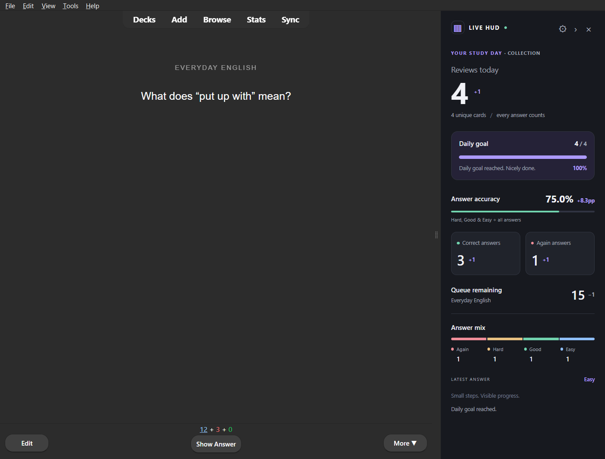
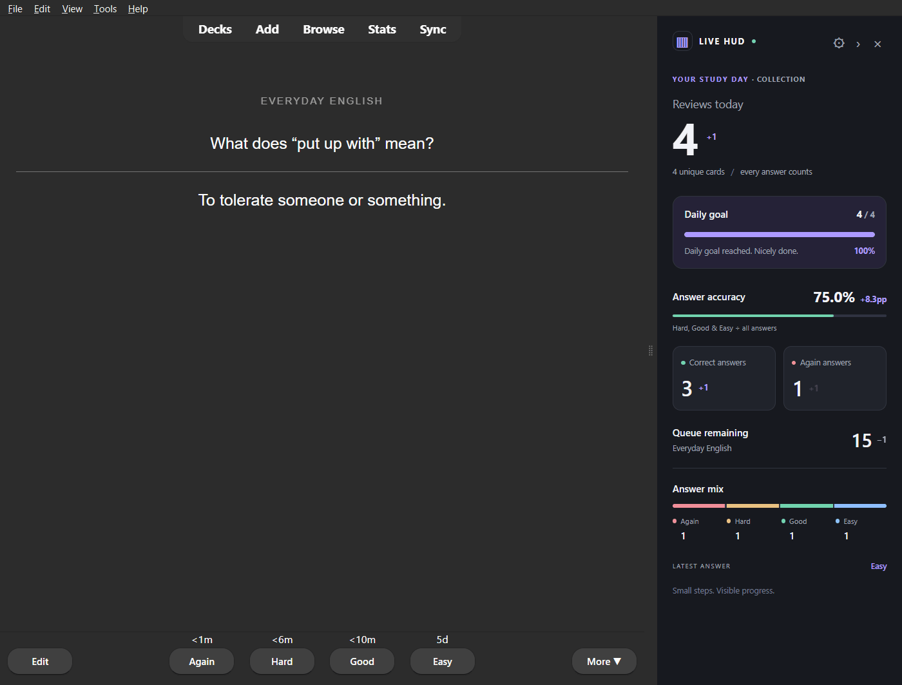
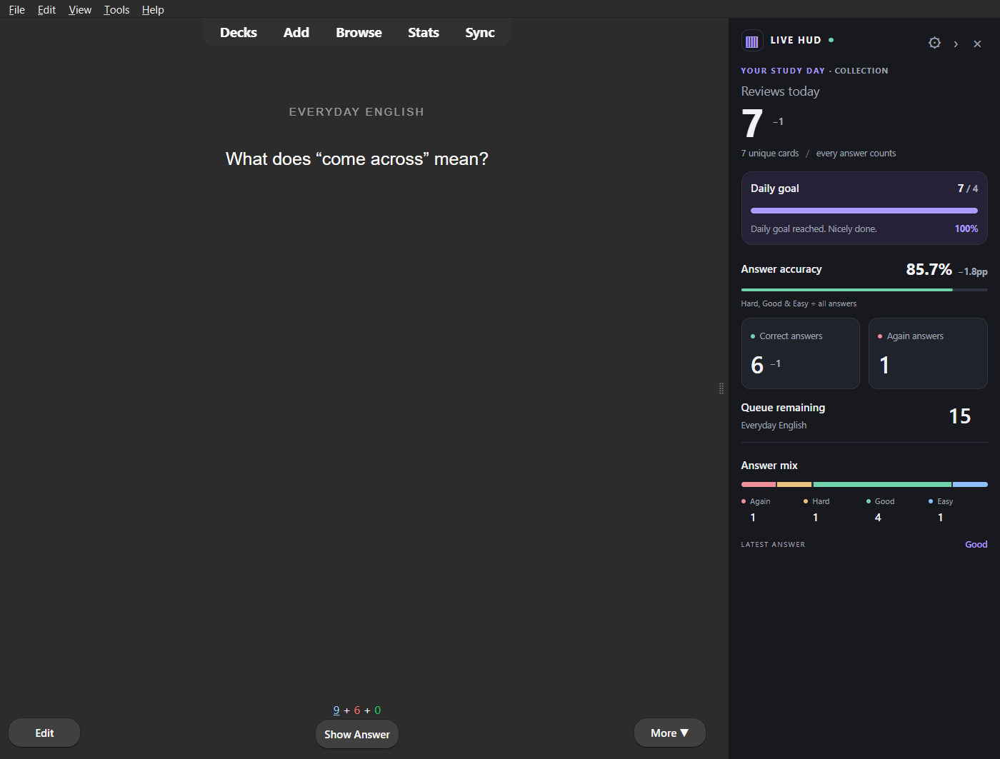
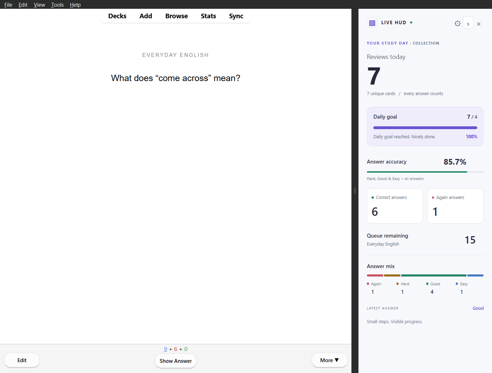

# Anki Live HUD

**Small steps. Visible progress.**

A persistent, animated statistics sidebar for the native Anki Desktop reviewer.
Every Again, Hard, Good or Easy answer updates real collection statistics, with
smooth counters, subtle deltas and a daily-goal bar. Your flashcards stay at the center.

**v0.1.0-rc.1 · Free · MIT · Anki Desktop 26.09.3+ / Qt 6**

[Download the prerelease](https://github.com/alfredofdlv/anki-live-hud/releases/tag/v0.1.0-rc.1)
· [Guía en español: instalar y publicar](docs/publicar.md)



## Features

- Persistent Qt sidebar that stays alive across questions, answers and cards.
- Animated review events, correct answers, Again answers, answer accuracy and queue remaining.
- Separate unique-card count, configurable daily goal and subtle goal celebration.
- Again / Hard / Good / Easy distribution.
- Accurate undo/redo restoration from Anki's review log.
- Light, dark and automatic themes, compact layout, collapse and hide controls.
- Drag the native divider to resize; narrow windows collapse into an expandable rail.
- Native keyboard shortcuts and answer buttons, plus Anki/OS reduced-motion support.
- Offline operation with no telemetry, remote fonts or external runtime dependencies.



## Install on Windows

1. Use **Anki Desktop 26.09.3 or newer**.
2. Download `anki-live-hud-0.1.0-rc.1.ankiaddon` from the
   [release assets](https://github.com/alfredofdlv/anki-live-hud/releases/tag/v0.1.0-rc.1).
   Developers can also build it with `python scripts/build.py`.
3. In Anki, open **Tools → Add-ons → Install from file…**, choose that package and restart Anki.
4. Start reviewing a deck. Open **Tools → Anki Live HUD → Settings…** to customize it.

See the [Windows installation and test guide](docs/install-windows.md) for exact
steps, undo checks, animation preferences, troubleshooting and removal.
There is no AnkiWeb code yet; use the GitHub `.ankiaddon` download. This is a
public prerelease, with native Windows testing and the limitations below.

## What the numbers mean

**Reviews today** counts rated answer events in the collection's current Anki
study day. Answering a card twice counts twice. **Unique cards** counts distinct
card IDs during that same period.

**Correct answers** counts Hard, Good and Easy. **Again answers** counts Again.
**Answer accuracy** is `(Hard + Good + Easy) / all rated answers × 100`, including
learning and relearning. This is **not Anki's True Retention**. An empty day displays
an unavailable accuracy value instead of an invented percentage. Manual rescheduling
entries are excluded.

**Queue remaining** follows the selected study deck's actual new, learning and
review queue counts. Learning steps can keep it unchanged or increase it. It is
not an estimate of unique unseen cards or all cards due in the collection.

The **daily goal** is a target number of answer events, not a target for selecting
any particular rating. Daily statistics cover the whole collection. The study day
uses Anki's rollover, including local daylight-saving boundaries.

## Appearance and settings

Use Tools → Anki Live HUD → Settings, or the normal Anki add-on Config editor.
Defaults: enabled and visible, 304px expanded width, goal 100, automatic theme,
animations on, compact mode off, distribution visible. Anki and OS reduced-motion
preferences override the animation switch.

Click `›` to collapse or `×` to hide; restore using the rail or the Tools menu.
The preferred expanded width is 240–480 logical pixels. Windows narrower than
820 pixels collapse automatically. Preferences are stored locally by Anki.
See [configuration details](addon/config.md).




## Compatibility and limitations

The minimum supported version is deliberately **26.09.3**. Native Windows tests
were executed against the installed Anki 26.09.3, Python 3.13.15 and Qt 6.11.2,
with a fresh temporary profile and a separate single-instance key. The same Anki
version was also exercised in a development Qt 6.8.1 runtime.

Linux/macOS desktop behavior, future Anki versions and combinations with popular
third-party add-ons still need validation. AnkiMobile, AnkiDroid and AnkiWeb cannot
run this desktop add-on. Full-screen UI replacements or add-ons that rearrange
native docks may affect layout. The implementation uses official hooks without
patching reviewer/scheduler methods or changing card HTML.

An idle rollover refresh can take up to 30 seconds; answering or changing cards
refreshes immediately. Profile settings are local, not synced. FSRS-specific
metrics, activity charts, session pace, streaks, deck-filtered daily totals,
achievements and exports are planned, not included in this release.

## Development and tests

```powershell
python -m venv .venv
.\.venv\Scripts\python -m pip install pytest ruff tzdata
.\.venv\Scripts\python -m pytest -q
.\.venv\Scripts\ruff check addon tests scripts
.\.venv\Scripts\ruff format --check addon tests scripts
.\.venv\Scripts\python scripts\build.py
```

Install `aqt[qt]==26.9.3` to run actual scheduler tests. For browser/native UI
tests, add Playwright and Pillow. See [test instructions and results](docs/testing.md).
The unit and package suite, browser fixture and native reviewer harness are
separate so a browser fixture never substitutes for native integration.

```powershell
.\.venv\Scripts\python scripts\test_native.py --installed-exe "$env:LOCALAPPDATA\Programs\Anki\Anki.exe"
.\.venv\Scripts\python scripts\test_ui.py
.\.venv\Scripts\python scripts\preview.py
```

`preview.py` generates a self-contained HTML UI test fixture with explicitly
synthetic data; it is only a development aid. The product is the native add-on.
GitHub Actions runs lint, tests, real collection checks, browser checks and a
deterministic package build. It does not publish releases automatically.

## Project documentation

- [Architecture, API research and references](docs/research.md)
- [Testing and verification report](docs/testing.md)
- [Windows installation](docs/install-windows.md)
- [AnkiWeb listing draft](docs/ankiweb-listing.md)
- [Release checklist](docs/release.md)
- [Publication guide in Spanish](docs/publicar.md) · [Community announcement drafts](docs/anuncios.md)
- [Contributing](CONTRIBUTING.md) · [Changelog](CHANGELOG.md) · [MIT license](LICENSE)

Source is original and independent of Anki. Anki and Qt retain their own licenses.
The project was largely developed with AI assistance. The source and testing
evidence are public; the add-on itself has no AI-service dependency.
