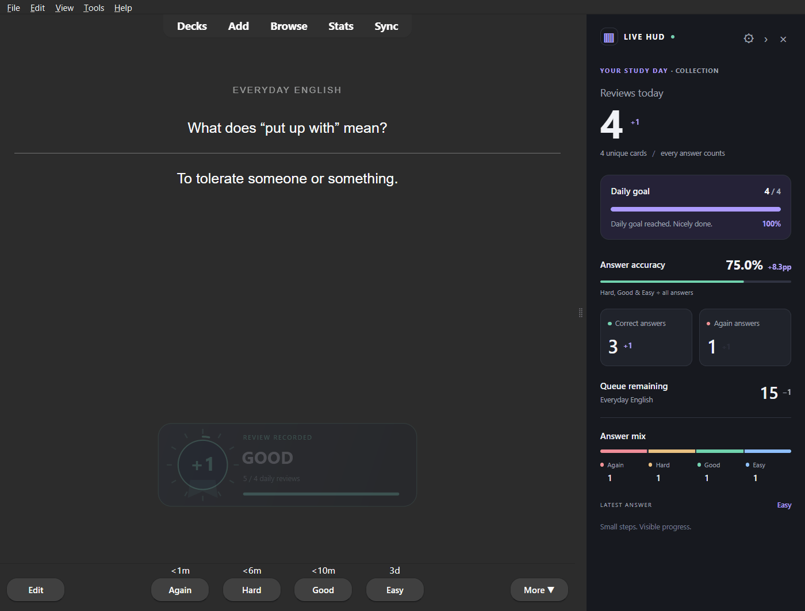
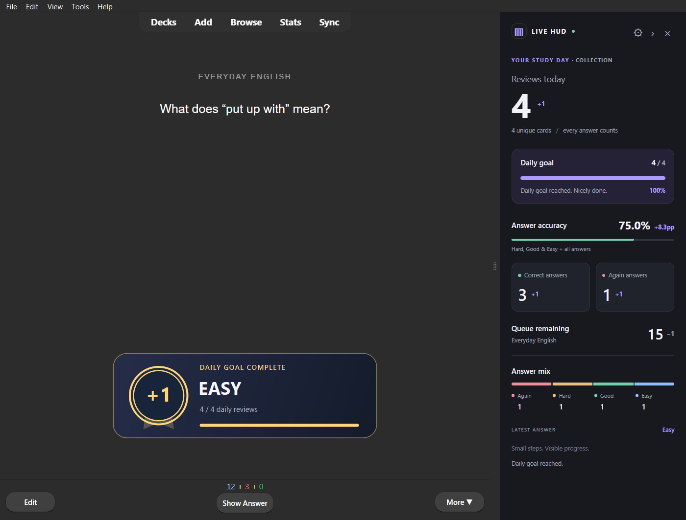

# Impact feedback — v0.2.0-rc.1 development preview

Every committed rating now creates a visible moment of progress over the review
area, instead of requiring you to watch the sidebar closely.

The layer displays an original geometric medal with **+1**, the chosen rating,
today's actual answer total and an animated daily-goal bar. A brief scale
overshoot, perimeter sweep and short radial rays give the entry impact; it then
holds and fades away. The default duration is **2.4 seconds**.

Actual milestones (10, 25, 50, 100, 250, 500 and 1000 daily answers) and crossing
the configured daily goal produce a gold variant. All four ratings receive the
same +1 review feedback. There is no XP, invented streak, or bonus for selecting Easy.

## Try the update

Build or install the prepared **`dist/anki-live-hud-0.2.0-rc.1.ankiaddon`** using
Tools → Add-ons → Install from file, then restart Anki. It updates the existing
`anki_live_hud` installation and retains preferences. New feedback settings have
defaults even for existing configurations. This development package does not
replace the previously published 0.1.0 release until a new release is published.

Under Tools → Anki Live HUD → Settings:

- **Show impact feedback over the review area** enables/disables the new layer.
- **Impact feedback duration** controls its lifetime, from 1200 to 5000 milliseconds.
- **Animate changes** enables movement if Anki/OS reduced motion is off.

Anki and OS reduced-motion preferences take precedence. In reduced motion, the
notification is still prominent and lasts for the selected duration, but remains
stationary. To see the full pop animation, turn reduced motion off in Anki and
the OS. This add-on never changes those global preferences for you.

## Behavior and implementation

The native `reviewer_did_answer_card` hook already represents a committed answer.
It immediately starts the visual +1 event. The existing serialized collection
read then supplies the real totals and progress. No permanent counters are added.

One Qt child widget above the card webview renders the layer with `QPainter`
and `QVariantAnimation`. Card HTML and reviewer methods remain untouched. The
widget is transparent outside its painted panel, transparent to mouse events,
and cannot take keyboard focus. It does not cover the native answer buttons.
Long cards may temporarily sit behind the notification; the layer can be disabled.

Rapid answers restart the same animation and expiry timer, replacing the previous
notice. Notices never queue up. Undo and other collection operations dismiss a
stale notice. Hiding/disabling the HUD, ending reviews and closing a profile also
stop and hide it. It works while the sidebar is collapsed into its rail.

OS motion preference is reported through the existing independent HUD bridge;
both the native layer and browser counters honor it. UI animation uses no network
requests, dependencies, full-screen flashes, sound or scheduler changes.

## Validation

Tested in the installed Windows Anki 26.09.3 / Qt 6.11.2 using a separate temporary
profile. Actual keyboard ratings, button clicks, repeated answers, goal completion,
notification expiry, undo, reduced motion, feedback disable, restart and queue
completion pass without Python/JavaScript errors. The GIF and images above come
from these real reviews, not a standalone UI mockup.

36 Python tests cover existing behavior plus progress/milestone derivation,
goal changes, day boundaries, animation timing, settings migration and recovery
from optional feedback initialization failures. 23 browser checks additionally
verify OS motion messages reach the native bridge. Machine-readable reports for
this update are in [evidence/impact/](evidence/impact/).

macOS/Linux native rendering and third-party add-on combinations remain unverified.
The existing Windows/native test host workaround for proxy discovery remains
confined to test code, as documented in [testing.md](testing.md).

Qt references: [QVariantAnimation](https://doc.qt.io/qt-6/qvariantanimation.html),
[QWidget](https://doc.qt.io/qt-6/qwidget.html),
[widget attributes](https://doc.qt.io/qt-6/qt.html#WidgetAttribute-enum).
