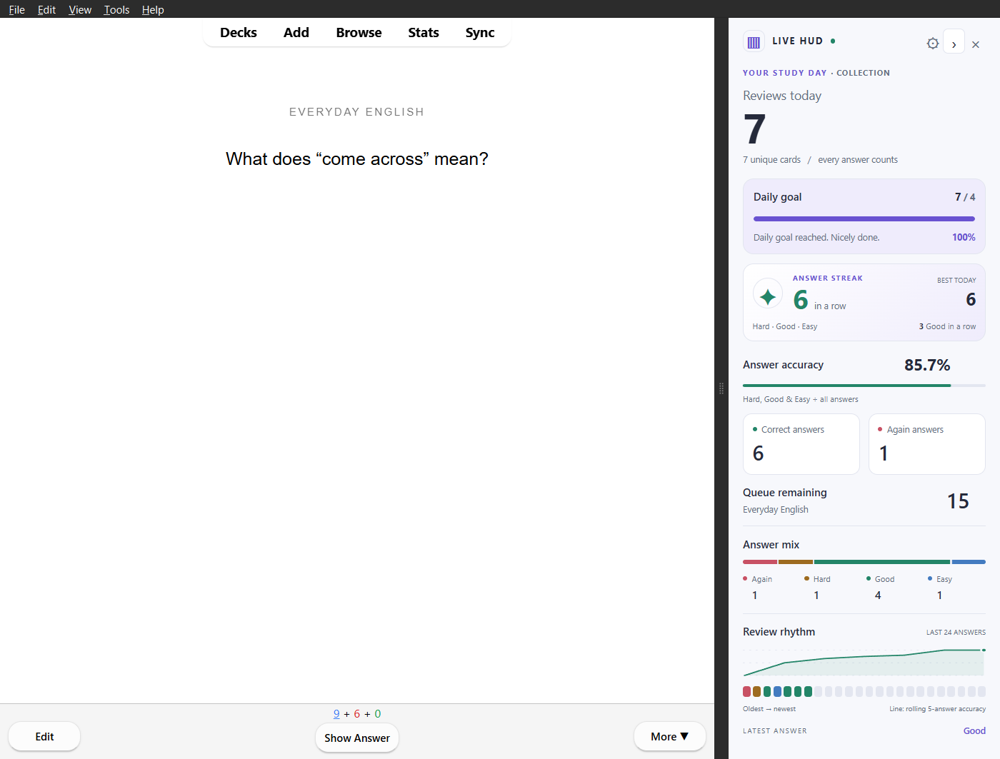
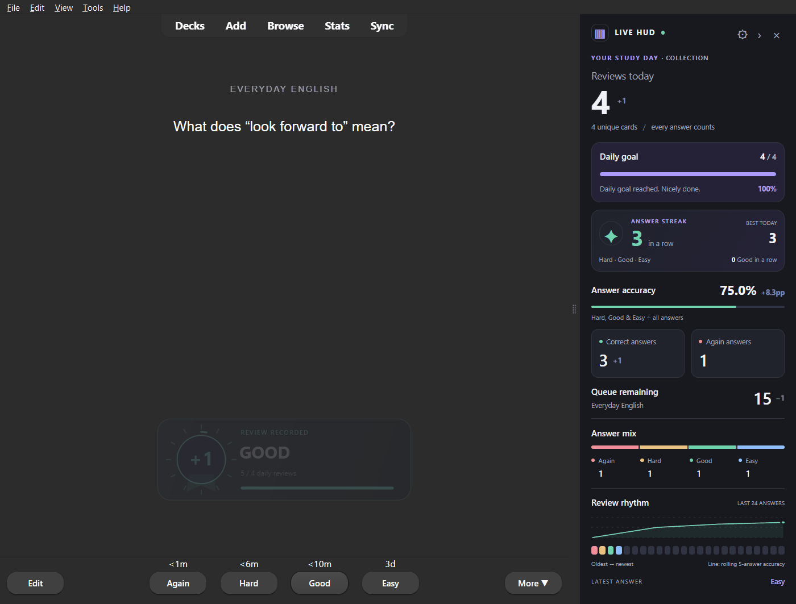

# Answer streaks and charts — v0.2.0-rc.2 preview

The reviewer sidebar now includes:

- **Answer streak:** consecutive Hard, Good or Easy ratings in the current study day.
- **Best today:** the longest such run in the same period.
- **Good in a row:** a separate count of strictly consecutive Good ratings.
- **Review rhythm:** an SVG line of rolling answer accuracy plus a colored history
  strip showing up to the last 24 rated answers, oldest to newest.

These figures are collection-wide, like the daily totals. They count answer
events, not unique cards or calendar days studied. Again starts a fresh passing
run; Hard and Easy continue that run but restart the separate Good-only counter.
Choosing Easy gives no extra credit. Rate cards according to your actual recall.

The line shows the fraction of Hard/Good/Easy ratings among the most recent
five answers at each point (fewer when the day has just started). It is a
rating-based percentage, **not True Retention** or a prediction of learning.
The x-axis is answer order, not elapsed time. History cells have equal height;
their colors classify ratings without presenting Easy as a higher score.

## Native streak feedback

The impact layer also recognizes actual runs of 5, 10, 20, 50 and 100 passing
answers. It displays a streak medal without XP, a rating multiplier or a
separate permanent achievement counter. Goal completion takes priority over
streak feedback when both occur on the same answer.

## Installation and controls

Install the prepared `dist/anki-live-hud-0.2.0-rc.2.ankiaddon` using Tools →
Add-ons → Install from file, then restart Anki. It updates the existing package
and keeps preferences. This is a development preview on the feature branch;
the published 0.1.0 prerelease has not been replaced.

Under Tools → Anki Live HUD → Settings, use **Show answer streak and today's
best** and **Show recent-answer chart** to hide either block independently.
The sidebar uses denser spacing when insights are visible and remains scrollable
in short windows. Compact mode and reduced-motion preferences still apply.

## Correctness and performance

The backend reads only the current study day's indexed `revlog.id` range, on
Anki's serialized collection worker. The same filters as the daily counters
exclude manual/rescheduling rows. Exact run lengths and records use the whole
study day; the visual history alone is limited to 24 answers. Rolling values
retain preceding context even at the beginning of that 24-answer window.

No independent counters are persisted. Undoing Again restores the previous
run; undoing a successful answer can reduce both the current run and today's
record. Restart and deck switches retain collection-wide runs. At Anki's
study-day rollover they start over with the new day's history.

There are no chart frameworks, network requests or scheduler changes. The SVG
and at most 24 history cells update only when their data changes, while counters
use the existing animation loop. The optional streak medal reuses the existing
mouse-transparent native overlay.

## Executed validation

49 Python tests and 34 browser checks passed. Tests cover exact Good/pass-run
definitions, runs longer than the chart window, rolling context, day bounds,
excluded review-log types, streak medals and actual Anki undo/redo. Browser
checks cover the SVG/timeline, visibility switches, rapid answers, Again/reset,
undo restoration, narrow layout, reduced motion and no external requests.

Native installed Windows Anki 26.09.3 / Qt 6.11.2 review/restart/queue-completion
tests passed with a fresh temporary profile. They verify actual rendered
streaks, undo and a five-answer streak medal. Images above show real Anki test
reviews, not a browser substitute. Reports are in [evidence/insights/](evidence/insights/).

Native macOS/Linux rendering and combinations with third-party UI add-ons
remain unverified. The existing [impact feedback notes](impact-feedback.md)
describe the native layer and accessibility behavior.
